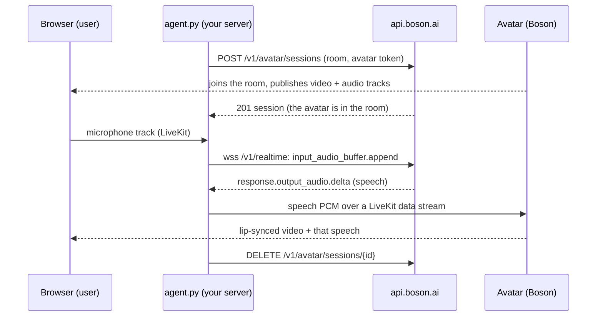

> ## Documentation Index
> Fetch the complete documentation index at: https://docs.boson.ai/llms.txt
> Use this file to discover all available pages before exploring further.

# Realtime sessions

> Build the smallest realtime avatar: Higgs Realtime talks, a Higgs Avatar lip-syncs it live in your LiveKit room.

A realtime session adds a face to a voice agent. The conversation runs in a LiveKit room, as a voice agent's does today; Boson adds an avatar participant to that room that renders lip-synced video, live, for the speech your agent produces. This page builds the whole thing from zero: a LiveKit room, one Python script that holds a Higgs Realtime conversation and drives the avatar, and a browser page where you talk to it and watch it answer.

```text Model theme={null}
higgs-avatar
```

```text Sessions endpoint theme={null}
https://api.boson.ai/v1/avatar/sessions
```

> [!NOTE]
>
> This is the live counterpart of `POST /v1/videos`, with the same `higgs-avatar` model. Video jobs render a finished clip from a still image and an audio file; a realtime session renders continuously, in a room, from audio that arrives as the agent speaks. The avatar does not listen or talk by itself: your voice agent does, and the avatar lip-syncs to its output.

> [!WARNING]
>
> You need a Boson API key (`BOSON_API_KEY`) and a LiveKit Cloud project with its URL, API key and secret (`LIVEKIT_URL`, `LIVEKIT_API_KEY`, `LIVEKIT_API_SECRET`); nothing here runs without both. Boson does not provide the room, and self-hosted LiveKit is not supported. See [Before you begin](#before-you-begin).

## How it works



Four participants, three of them yours:

1. **The user** joins the room from a browser and publishes a microphone track. They subscribe to the avatar's video and audio like any other participant's.
2. **Your agent** (`agent.py` below) joins the same room as a participant. It forwards the user's microphone audio to Higgs Realtime, and sends the model's spoken reply to the avatar over a LiveKit data stream (the LiveKit Agents avatar audio protocol: 24 kHz 16-bit PCM, plus a "playback finished" callback the avatar sends back). The agent never publishes audio itself.
3. **Higgs Realtime** holds the conversation over one WebSocket: it listens, detects turns, and answers in speech. Same API as the [Higgs Realtime quickstart](https://docs.boson.ai/models/higgs-realtime/quickstart.md).
4. **The avatar** is the participant Boson adds to your room, under the identity named in your request. It renders the speech it receives into lip-synced video and publishes video and audio tracks, in sync. It is in the room when the create call returns, and leaves when you release the session, when `max_duration_seconds` elapses, or when everyone else has left.

The avatar's audio and video stay inside your LiveKit room; the `/v1/avatar/sessions` routes never carry media.

> [!TIP]
>
> Already on LiveKit Agents? [With LiveKit Agents](#with-livekit-agents) builds the same agent from two plugins in about 30 lines. The steps below build the pieces by hand so you see how they fit.

## Before you begin

**Boson.** A [Boson API key](https://docs.boson.ai/authentication.md) in `BOSON_API_KEY`, with available credit (new accounts [claim their free trial credit](https://docs.boson.ai/free-trial-credit.md) first). One key covers both the avatar session and the Higgs Realtime conversation.

**LiveKit.** A [LiveKit Cloud](https://cloud.livekit.io) project (the free tier is enough). The avatar joins LiveKit Cloud project URLs (`wss://<your-project>.livekit.cloud`); a self-hosted LiveKit server is not supported, and a session pointing at one is refused with `422 invalid_livekit_url`. In the Cloud dashboard, create a project, then open its **Settings → Keys** and add a key ([Keys and tokens](https://docs.livekit.io/home/cloud/keys-and-tokens/) in LiveKit's docs). The project URL is shown at the top of the dashboard. Those are the three values every script below reads; rooms need no setup, a room exists as soon as the first participant joins it:

```bash theme={null}
export LIVEKIT_URL="wss://<your-project>.livekit.cloud"
export LIVEKIT_API_KEY="API..."
export LIVEKIT_API_SECRET="..."
export BOSON_API_KEY="bai-..."
```

Install the [LiveKit CLI](https://docs.livekit.io/reference/developer-tools/livekit-cli/) too; it mints the browser's token in one command and reads the same three variables:

```bash theme={null}
brew install livekit-cli          # or on Linux (needs curl and jq): curl -sSL https://get.livekit.io/cli | bash
```

**Python 3.10+** with the LiveKit SDKs (the `livekit-agents` package brings the room client, the token helper and the avatar audio protocol; this page was written against 1.8), plus a WebSocket client:

```bash theme={null}
pip install livekit-agents websockets requests
```

**An avatar.** List the avatars your key can use with `GET /v1/avatars`; Boson presets such as `builtin_claire_v1`, `builtin_emma_v1` and `builtin_james_v1` are available to every key:

```bash theme={null}
curl -fsS https://api.boson.ai/v1/avatars \
  -H "Authorization: Bearer $BOSON_API_KEY" | jq '.data[] | {avatar_id, name}'
```

## Step 1: the agent

Save this as `agent.py`. It does four things, in order: puts the avatar in the room, joins the room itself, runs the conversation with Higgs Realtime while streaming the replies to the avatar, and releases the avatar when you stop it.

```python agent.py theme={null}
import asyncio
import base64
import json
import os
from datetime import timedelta

import requests
import websockets
from livekit import api, rtc
from livekit.agents.voice.avatar import DataStreamAudioOutput

ROOM = "avatar-demo"
AGENT_IDENTITY = "agent"          # this script: the participant the avatar listens to
AVATAR_IDENTITY = "boson-avatar"  # the participant the avatar joins as
AVATAR_ID = "builtin_claire_v1"
MAX_DURATION_SECONDS = 1800

BOSON = {"Authorization": f"Bearer {os.environ['BOSON_API_KEY']}"}
BOSON_BASE_URL = os.environ.get("BOSON_BASE_URL", "https://api.boson.ai/v1")
BOSON_REALTIME_URL = os.environ.get("BOSON_REALTIME_URL", "wss://api.boson.ai/v1/realtime")


def livekit_token(identity, *, publish, subscribe, publish_on_behalf=None):
    token = (
        api.AccessToken(os.environ["LIVEKIT_API_KEY"], os.environ["LIVEKIT_API_SECRET"])
        .with_identity(identity)
        .with_grants(
            api.VideoGrants(
                room_join=True,
                room=ROOM,
                can_publish=publish,
                can_subscribe=subscribe,
                can_publish_data=True,
                can_publish_sources=["camera", "microphone"] if publish else None,
            )
        )
        .with_ttl(timedelta(seconds=MAX_DURATION_SECONDS + 300))
    )
    if publish_on_behalf:  # optional: LiveKit UIs then show the avatar as part of the agent
        token = token.with_kind("agent").with_attributes({"lk.publish_on_behalf": publish_on_behalf})
    return token.to_jwt()


async def main():
    # 1. Put the avatar in the room. It is there when this returns.
    r = requests.post(
        f"{BOSON_BASE_URL}/avatar/sessions",
        headers=BOSON,
        json={
            "avatar_id": AVATAR_ID,
            "transport": {
                "type": "livekit",
                "url": os.environ["LIVEKIT_URL"],
                "room_name": ROOM,
                "participant_token": livekit_token(
                    AVATAR_IDENTITY, publish=True, subscribe=False, publish_on_behalf=AGENT_IDENTITY
                ),
                "participant_identity": AVATAR_IDENTITY,
                "publisher_identity": AGENT_IDENTITY,
            },
            "max_duration_seconds": MAX_DURATION_SECONDS,
        },
        timeout=60,
    )
    r.raise_for_status()
    session = r.json()
    print("avatar session", session["id"], session["status"], flush=True)

    # 2. Join the room as the agent. Speech goes to the avatar over a data
    #    stream; the avatar publishes it as its own audio track, in sync with
    #    the video, so the agent itself never publishes audio.
    room = rtc.Room()
    await room.connect(os.environ["LIVEKIT_URL"], livekit_token(AGENT_IDENTITY, publish=True, subscribe=True))
    to_avatar = DataStreamAudioOutput(
        room, destination_identity=AVATAR_IDENTITY, sample_rate=24000, wait_remote_track=rtc.TrackKind.KIND_AUDIO
    )

    try:
        # 3. Talk to Higgs Realtime: the user's microphone in, the model's speech out.
        async with websockets.connect(BOSON_REALTIME_URL, additional_headers=BOSON) as ws:
            await ws.send(json.dumps({
                "type": "session.update",
                "session": {
                    "model": "higgs-realtime",
                    "instructions": "You are a friendly assistant with a face. Keep answers short.",
                    "audio": {
                        "input": {"turn_detection": {"type": "server_vad"}},
                        "output": {"voice": "default"},
                    },
                },
            }))

            async def forward_user_audio(track):
                # 24 kHz, 16-bit mono PCM: what the model expects, base64 in JSON.
                async for event in rtc.AudioStream(track, sample_rate=24000, num_channels=1):
                    try:
                        await ws.send(json.dumps({
                            "type": "input_audio_buffer.append",
                            "audio": base64.b64encode(bytes(event.frame.data)).decode(),
                        }))
                    except websockets.ConnectionClosed:
                        return  # the conversation is over (Ctrl-C, or the server closed it)

            @room.on("track_subscribed")
            def on_track(track, _publication, participant):
                if participant.identity != AVATAR_IDENTITY and track.kind == rtc.TrackKind.KIND_AUDIO:
                    asyncio.create_task(forward_user_audio(track))

            for participant in room.remote_participants.values():  # users already in the room
                for publication in participant.track_publications.values():
                    if publication.track is not None:
                        on_track(publication.track, publication, participant)

            speaking = False  # is the avatar still playing something we sent?

            @to_avatar.on("playback_finished")
            def on_played(_event):
                nonlocal speaking
                speaking = False

            async for message in ws:
                event = json.loads(message)
                if event["type"] == "response.output_audio.delta":
                    pcm = base64.b64decode(event["delta"])
                    await to_avatar.capture_frame(rtc.AudioFrame(pcm, 24000, 1, len(pcm) // 2))
                    speaking = True
                elif event["type"] == "response.done":
                    to_avatar.flush()  # end of this utterance; the avatar reports when it has played it
                elif event["type"] == "input_audio_buffer.speech_started" and speaking:
                    to_avatar.clear_buffer()  # the user barged in: stop the avatar talking
                    speaking = False
                elif event["type"] == "response.output_audio_transcript.done":
                    print("avatar said:", event["transcript"], flush=True)
                elif event["type"] == "error":
                    print("realtime error:", event, flush=True)
    finally:
        # 4. Release the avatar when the conversation ends.
        requests.delete(f"{BOSON_BASE_URL}/avatar/sessions/{session['id']}", headers=BOSON, timeout=30)
        await room.disconnect()


if __name__ == "__main__":
    try:
        asyncio.run(main())
    except KeyboardInterrupt:
        pass  # Ctrl-C: the session was released on the way out
```

Run it:

```bash theme={null}
python agent.py
# avatar session avrt_3f9c2a7e8b1d4c6f active
```

The avatar is now in the room `avatar-demo`, waiting for someone to talk to. A few things worth knowing about what the script does:

* **Two tokens, both minted by you.** The avatar's token (identity `boson-avatar`) lets the avatar join your room and publish camera and microphone tracks; it never needs to subscribe. The agent's token lets this script hear the user. Boson never sees your LiveKit API secret, only the avatar's token, and does not inspect it: a token with the wrong identity or grants fails when the avatar tries to join.
* **`publisher_identity` is the agent.** The avatar only accepts audio from that participant, over a data stream. `DataStreamAudioOutput` from `livekit-agents` speaks that protocol: `capture_frame` sends PCM, `flush` marks the end of an utterance, `clear_buffer` tells the avatar to drop what it has not played yet (used when the user interrupts), and the avatar reports `playback_finished` when it has played everything. The model produces speech faster than real time, so that event, not `response.done`, is what says the avatar has stopped talking.
* **One user per session.** The script forwards every non-avatar participant's microphone to the same conversation. For a demo that is one person; a product gives each user their own room, agent and session.
* **The conversation is plain Higgs Realtime.** The WebSocket, `session.update`, `input_audio_buffer.append` and `response.output_audio.delta` are exactly the [quickstart](https://docs.boson.ai/models/higgs-realtime/quickstart.md); the only difference is where the audio comes from (the user's LiveKit track) and goes to (the avatar instead of a speaker).
* **Ctrl-C releases the session.** The `finally` block sends the `DELETE`. If your process dies without it, Boson still ends the session at `max_duration_seconds` or once the room is empty, but a forgotten session keeps its capacity slot until then. The demo starts the avatar before anyone is in the room; in production, create the session when the user joins.

## Step 2: talk to it

The user needs a token for the room and a page that joins it. Mint the token with the LiveKit CLI (it reads the `LIVEKIT_*` variables you exported):

```bash theme={null}
lk token create --join --room avatar-demo --identity user --valid-for 1h --token-only
```

Save this as `viewer.html`. It is the whole client: a **Join** button and a video element for the avatar:

```html viewer.html theme={null}
<!doctype html>
<meta charset="utf-8" />
<title>Realtime avatar</title>
<button id="join">Join</button>
<video id="avatar" autoplay playsinline style="display:block;width:480px;height:640px;background:#000"></video>
<script src="https://unpkg.com/livekit-client@2.15.0/dist/livekit-client.umd.js"></script>
<script>
  const params = new URLSearchParams(location.search);
  const room = new LivekitClient.Room();
  room.on(LivekitClient.RoomEvent.TrackSubscribed, (track, _publication, participant) => {
    if (participant.identity !== "boson-avatar") return;
    if (track.kind === "video") track.attach(document.getElementById("avatar"));
    else document.body.appendChild(track.attach()); // the avatar's voice
  });
  document.getElementById("join").onclick = async () => {
    await room.connect(params.get("url"), params.get("token"));
    await room.localParticipant.setMicrophoneEnabled(true);
  };
</script>
```

Open it in a browser with two query parameters. `url` is the `LIVEKIT_URL` you exported above, `wss://` prefix included, and `token` is the string `lk token create` just printed:

```text theme={null}
file:///path/to/viewer.html?url=wss://<your-project>.livekit.cloud&token=<output of lk token create>
```

Click **Join**. The page connects, turns on your microphone, and attaches the avatar's video and audio as soon as they arrive. A token in the URL is fine for a demo; a product hands it to the page from your server.

Say hello. Within a second or two the avatar answers, lips moving with the words, and `agent.py` prints the transcript of what it said. Interrupt it mid-sentence and it stops. That is the whole loop: everything else on this page is reference.

> [!NOTE]
>
> The browser only ever holds a LiveKit room token, which is what LiveKit is designed to hand to clients. Your Boson API key and LiveKit API secret stay in `agent.py` on your server.

> [!NOTE]
>
> The token expires after the `--valid-for` you gave it (an hour above). If the page stops connecting later, rerun the `lk token create` command and open the page again with the new token.

## With LiveKit Agents

If your agent runs on [LiveKit Agents](https://docs.livekit.io/agents/), two plugins replace `agent.py`: LiveKit's OpenAI plugin holds the Higgs Realtime conversation (Higgs Realtime speaks the OpenAI Realtime protocol), and the Boson Avatar plugin puts the avatar in the room, streams the agent's speech to it and releases it when the agent stops. The room, the avatar and `viewer.html` stay exactly as above.

Install the plugins (git is needed for the last one):

```bash theme={null}
pip install "livekit-agents==1.8.8" "livekit-plugins-openai==1.8.8" \
  "livekit-plugins-boson-avatar @ git+https://github.com/warlockee/agents@808a4249850945f91609a9145e50ffea1c9802c4#subdirectory=livekit-plugins/livekit-plugins-boson-avatar"
```

> [!NOTE]
>
> The Boson Avatar plugin release that matches this API is not on PyPI yet, so the command installs it from source, pinned to one commit. Once it is released, `pip install livekit-plugins-boson-avatar` replaces that line; the code below should not need to change.
>
> If `livekit-plugins-boson-avatar` is already installed (for example through `livekit-agents[boson-avatar]`), run `pip uninstall -y livekit-plugins-boson-avatar` first: the 1.8.8 release on PyPI does not work with this API, and pip keeps it because the version numbers match.

Save this as `livekit_agent.py`. It reads the same four variables as `agent.py`:

```python livekit_agent.py theme={null}
import os

from livekit.agents import Agent, AgentServer, AgentSession, JobContext, cli
from livekit.plugins import boson_avatar, openai
from openai.types.realtime import AudioTranscription
from openai.types.realtime.realtime_audio_input_turn_detection import ServerVad

BOSON_BASE_URL = os.environ.get("BOSON_BASE_URL", "https://api.boson.ai/v1")

server = AgentServer()


@server.rtc_session()
async def entrypoint(ctx: JobContext):
    session = AgentSession(
        llm=openai.realtime.RealtimeModel(
            base_url=BOSON_BASE_URL,
            api_key=os.environ["BOSON_API_KEY"],
            model="higgs-realtime",
            voice="default",
            turn_detection=ServerVad(type="server_vad"),
            input_audio_transcription=AudioTranscription(model="higgs-stt-3.1"),
        )
    )
    avatar = boson_avatar.AvatarSession(
        avatar_id="builtin_claire_v1",
        api_url=BOSON_BASE_URL,
        avatar_participant_identity="boson-avatar",  # the identity viewer.html shows
    )
    await avatar.start(session, room=ctx.room)  # before session.start(): routes the agent's speech to the avatar
    await session.start(agent=Agent(instructions="You are a friendly assistant."), room=ctx.room)


if __name__ == "__main__":
    cli.run_app(server)
```

Stop `agent.py` and close the Step 2 page (the agent only goes into new rooms), then start the worker:

```bash theme={null}
python livekit_agent.py dev
```

The worker waits for rooms (LiveKit Agents 1.8 prints a deprecation notice for this CLI; it still works). Open `viewer.html` as in [Step 2](#step-2-talk-to-it) and click **Join**: the room is created, LiveKit sends the agent into it, and the avatar joins a few seconds later. Ctrl-C stops the worker and releases the avatar.

* **Three OpenAI defaults fail on Higgs Realtime.** The OpenAI plugin's defaults are OpenAI's, and Higgs Realtime refuses these in `session.update`, so the code sets them:
  * `voice`: OpenAI voice names do not exist here; use `"default"`, a Boson preset or your own voice ([Voices](https://docs.boson.ai/models/higgs-realtime/guides/audio-and-voices.md#voices)).
  * `turn_detection`: the plugin defaults to `semantic_vad` with `eagerness="medium"`, and Higgs Realtime only accepts `eagerness="auto"`. Pass `server_vad` as above.
  * `input_audio_transcription`: the plugin defaults to an OpenAI transcription model, which is not available here; use `higgs-stt-3.1`.
* **The avatar plugin does the avatar half of `agent.py`.** It mints the avatar's token, creates the session with the agent as `publisher_identity`, sends the agent's speech over the LiveKit data stream (and clears it when the user interrupts), and sends the `DELETE` when the agent stops. Its default avatar identity is `boson-avatar-agent`; `avatar_participant_identity="boson-avatar"` keeps `viewer.html` working unchanged.
* **Start the avatar first.** `avatar.start()` replaces the session's audio output with a data stream to the avatar; `session.start()` only publishes the agent's own audio track when no output is set yet. Call them in this order.
* **One avatar per room.** With no `agent_name`, LiveKit sends the worker into every new room in your project (in `dev` and `start` alike), and each one starts an avatar session that holds a capacity slot until it ends. Set `agent_name` and dispatch explicitly to choose the rooms.

## The session object

`POST /v1/avatar/sessions` returns it with `201`; `GET` and `DELETE /v1/avatar/sessions/{session_id}` return the current state:

```json theme={null}
{
  "id": "avrt_3f9c2a7e8b1d4c6f",
  "object": "avatar.realtime.session",
  "status": "active",
  "model": "higgs-avatar",
  "avatar_id": "builtin_claire_v1",
  "avatar_identity": "boson-avatar",
  "created_at": "2026-10-16T09:12:04.318201+00:00",
  "expires_at": "2026-10-16T09:42:04.318201+00:00",
  "ended_at": null
}
```

| `status` | Meaning | Client action |
| - | - | - |
| `active` | The avatar is in the room and rendering. | Stream audio to it; release it when done. |
| `releasing` | Your `DELETE` was accepted; the end is not confirmed yet. | Poll `GET` until `terminated`, if you need that certainty. |
| `terminated` | Ended: released, expired, the room emptied, or ended by Boson for another reason. Retrievable until a few minutes after `expires_at`, then `404`. | Nothing. Create a new session for a new conversation. |

Boson ends every session by itself, even if your `DELETE` never arrives: at `expires_at`, or once every other participant has left the room. Release sessions anyway: a forgotten session keeps its slot until it expires.

## Capacity and retries

Avatar capacity is limited, and each session occupies one slot for its whole duration. When every slot is in use, `POST /v1/avatar/sessions` returns `429` with `code: "capacity_exhausted"` and a `Retry-After` header (seconds). Retry after that delay; a slot frees as soon as another session ends. Start the avatar only when a user is actually present, keep `max_duration_seconds` close to your real call length, and release promptly.

`503` responses with `code: "service_unavailable"` are transient and also carry `Retry-After`. A `429` with `type: rate_limit_error` is the ordinary per-key rate limit: back off and retry. A `429` with `type: insufficient_quota` is a billing refusal and does not recover by retrying; see [Common error types](https://docs.boson.ai/api-reference/errors.md).

Creation is not idempotent. If the create call times out, check the room for the avatar participant before retrying, and release any duplicate session.

Sessions run up to `max_duration_seconds` (3600 s by default, per account); `output` picks the video size (default 480x640). Every request field, limit and error code is in the [Avatar Realtime API reference](https://docs.boson.ai/api-reference/avatar-realtime/overview.md).

## It didn't work?

> **POST /v1/avatar/sessions returns 429 capacity\_exhausted**
>
> Every avatar slot is in use, whatever `avatar_id` you ask for. Wait `Retry-After` seconds and retry. A session you forgot to release still counts against capacity until `max_duration_seconds` elapses or the room empties; release it with `DELETE`.

> **POST /v1/avatar/sessions returns 422 invalid\_livekit\_url**
>
> The avatar only joins LiveKit Cloud projects. Set `LIVEKIT_URL` to the project URL exactly as the Cloud dashboard shows it, `wss://<your-project>.livekit.cloud`, with no port, path or query. A self-hosted LiveKit server is refused.

> **The session is active but no avatar appears in the room**
>
> The avatar's token was refused by LiveKit. Check that it was minted with the same `LIVEKIT_API_KEY`/`SECRET` as the project in `LIVEKIT_URL`, for identity `participant_identity`, with `room_join`, `can_publish` and `can_publish_data`, and a TTL longer than the session. Boson does not validate the token; `GET` the session a few seconds later and you will see it `terminated`.

> **Video shows, the model answers in the agent's log, but the avatar stays silent and still**
>
> The avatar only accepts audio from `publisher_identity`. Make sure the identity the agent connects with is the one you named in the create request, and that you send the audio with `DataStreamAudioOutput` (not by publishing a microphone track).

> **The avatar never answers**
>
> The agent hears nothing. In the browser, allow the microphone and check that `setMicrophoneEnabled(true)` ran after `connect`. In `agent.py`, the `track_subscribed` handler must see the user's audio track: the agent's token needs `can_subscribe`. With `server_vad` the model answers on its own when you stop speaking; a `realtime error` line in the agent's output means the WebSocket side refused something (an invalid key closes with code 3000, no credit gives `insufficient_quota`).

## Next steps

> **[Avatar Realtime API reference](https://docs.boson.ai/api-reference/avatar-realtime/overview.md)**
>
> Routes, the session object, transport fields and error codes.

> **[Higgs Realtime](https://docs.boson.ai/models/higgs-realtime/overview.md)**
>
> Voices, turn detection, interruptions and tool calling for the conversation behind the avatar.


This documentation is built and hosted on [Mintlify](https://mintlify.com), a developer documentation platform.