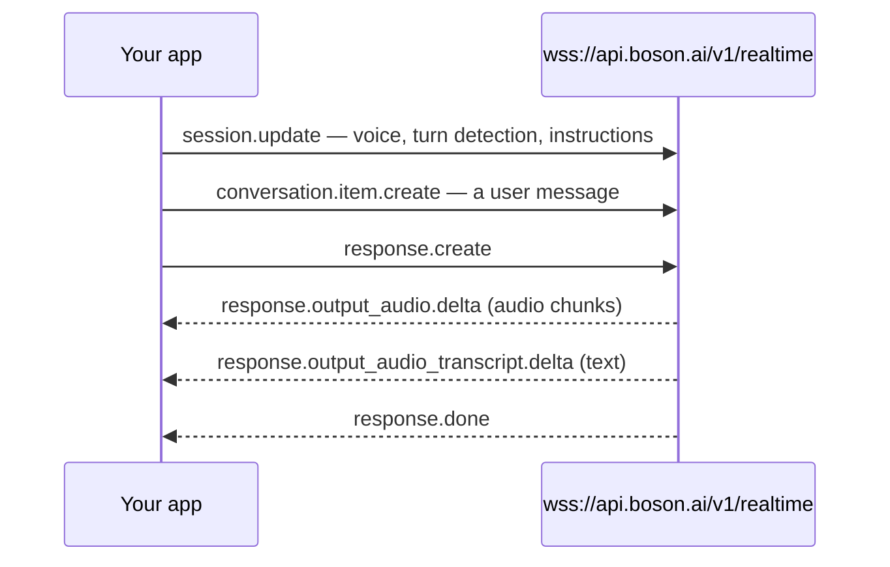

> ## Documentation Index
> Fetch the complete documentation index at: https://docs.boson.ai/llms.txt
> Use this file to discover all available pages before exploring further.

# Quickstart

> Every step from a fresh account to a working Higgs Realtime voice assistant.

This quickstart walks the full path to a working voice app: set up your account, then build a browser voice assistant with the official tutorial — or hear your first spoken reply with one short Python script. One session does everything — the model listens and speaks natively, with no separate transcription or synthesis steps to manage.

> [!TIP]
>
> **Looking for an easier path?** [LiveKit](https://docs.boson.ai/models/higgs-realtime/integrations/livekit.md) and [Pipecat](https://docs.boson.ai/models/higgs-realtime/integrations/pipecat.md) have Higgs Realtime support built in and handle the WebSocket, audio, and interruption plumbing for you — often the fastest route to a production voice agent. Already running on OpenAI's Realtime API? [Migrate your existing integration](https://docs.boson.ai/models/higgs-realtime/migrate-an-existing-integration.md) with a few config changes. This page covers the raw WebSocket path — the best way to learn how the API actually works.

## How it works

Your app holds a single WebSocket session and exchanges JSON events with the model:



That's the whole loop. When you stream microphone audio instead of text, turn detection makes the last step automatic — the model replies on its own when you stop speaking, no `response.create` needed.

## Before you begin

Whichever path you take below, you need:

* A [Boson API key](https://docs.boson.ai/authentication.md) stored in `BOSON_API_KEY`
* Available credit — new accounts must claim their [free trial credit](https://docs.boson.ai/free-trial-credit.md) before their first API call

New to Boson AI? [Set up your account](https://docs.boson.ai/set-up-your-account.md) walks through all of it.

## Start with the tutorial

The easiest and most practical way to build with Higgs Realtime is the official tutorial: six parts that take you from zero to a working browser voice assistant, with a working checkpoint to fall back on after every part.

> **[Higgs Realtime API — a tutorial](https://github.com/boson-ai/higgs-realtime-tutorial)**
>
> TypeScript and React, verified against live sessions. Clone it, add your key, and build.

The parts arrive in the same order a real voice service comes together: keep your API key off the browser with ephemeral keys, open the first connection, stream a live microphone with turn detection and interruptions, rebuild a correct transcript from the event stream, add tool calling, and shape the system prompt. Finish it and you have touched every building block of a voice app once.

Building server-side instead — a phone agent, a voice pipeline — or want the smallest possible first step? The rest of this page plays a spoken reply with one short Python script.

## Hear a reply in Python

You need Python 3.10 or later with the `websockets` and `sounddevice` packages, and speakers or headphones — the reply plays as audio:

```bash theme={null}
export BOSON_API_KEY="bai-xxxx"
pip install websockets sounddevice
```

Connect, configure the session, send a text message, and play the model's spoken reply:

```python theme={null}
import asyncio
import base64
import json
import os
import sounddevice as sd
import websockets

async def voice_agent():
    # Speaker output matching the default audio format: 24 kHz, 16-bit, mono PCM
    speaker = sd.RawOutputStream(samplerate=24000, channels=1, dtype="int16")
    speaker.start()

    async with websockets.connect(
        "wss://api.boson.ai/v1/realtime",
        additional_headers={"Authorization": f"Bearer {os.environ['BOSON_API_KEY']}"}
    ) as ws:
        # Configure session
        await ws.send(json.dumps({
            "type": "session.update",
            "session": {
                "model": "higgs-realtime",
                "instructions": "You are a helpful assistant.",
                "audio": {
                    "input": {"turn_detection": {"type": "server_vad"}},
                    "output": {"voice": "default"}
                }
            }
        }))

        # Send a text message
        await ws.send(json.dumps({
            "type": "conversation.item.create",
            "item": {"type": "message", "role": "user",
                     "content": [{"type": "input_text", "text": "Hello!"}]}
        }))
        await ws.send(json.dumps({"type": "response.create"}))

        # Play audio responses as they stream in
        async for msg in ws:
            event = json.loads(msg)
            if event["type"] == "response.output_audio.delta":
                speaker.write(base64.b64decode(event["delta"]))
            elif event["type"] == "response.output_audio_transcript.done":
                print("Assistant:", event["transcript"])
            elif event["type"] == "response.done":
                break

    speaker.stop()

asyncio.run(voice_agent())
```

You should hear the assistant speak its reply out loud, then see its transcript printed.

The reply arrives as a stream of `response.output_audio.delta` events (base64 24 kHz 16-bit mono PCM) alongside `response.output_audio_transcript.delta` text, ending with `response.done`. To talk instead of type, stream microphone audio with `input_audio_buffer.append` — with `server_vad` turn detection the model detects when you stop speaking and responds on its own, no `response.create` needed.

> [!NOTE]
>
> Building for the browser or mobile? Don't ship your API key: mint a short-lived key with `POST /v1/realtime/client_secrets` and connect with the `bai-client-secret.<key>` subprotocol (see [Authentication](https://docs.boson.ai/models/higgs-realtime/guides/connections-and-sessions.md#authentication)). The [tutorial](#start-with-the-tutorial) above builds this flow end to end.

## It didn't work?

> **No sound, or an audio device error**
>
> `sounddevice` plays through your system's default output device. Check that a working output device is selected and unmuted. The transcript print (`Assistant: …`) confirms the model replied even if playback failed.

> **Connection closes with code 3000**
>
> Invalid API key (or an invalid/expired ephemeral key). Check `BOSON_API_KEY` is set in the shell running the script and matches a key in your [workspace](https://www.boson.ai/workspace/api-key). See [Authentication](https://docs.boson.ai/authentication.md).

> **error event with type insufficient\_quota, then close code 4429**
>
> A billing refusal — your key is fine, but the account has no available balance. New accounts must [claim their free trial credit](https://docs.boson.ai/free-trial-credit.md) first; otherwise [add credits](https://docs.boson.ai/account-billing/payment-and-credits.md) in [workspace billing](https://www.boson.ai/workspace/billing/overview). See [Common error types](https://docs.boson.ai/api-reference/errors.md).

## Go deeper

> **[Connections & sessions](https://docs.boson.ai/models/higgs-realtime/guides/connections-and-sessions.md)**
>
> Session configuration, limits, and lifecycle.

> **[Audio & voices](https://docs.boson.ai/models/higgs-realtime/guides/audio-and-voices.md)**
>
> Audio formats, preset voices, and custom voices.

> **[Turn detection & interruptions](https://docs.boson.ai/models/higgs-realtime/guides/turn-detection-and-interruptions.md)**
>
> `server_vad`, `semantic_vad`, and barge-in.

> **[Tool calling](https://docs.boson.ai/models/higgs-realtime/guides/tool-calling.md)**
>
> Let the model call your functions mid-conversation.

> **[LiveKit & Pipecat](https://docs.boson.ai/models/higgs-realtime/integrations/livekit.md)**
>
> Production voice-agent frameworks with Higgs Realtime built in.

> **[Migrate from OpenAI](https://docs.boson.ai/models/higgs-realtime/migrate-an-existing-integration.md)**
>
> The protocol is OpenAI Realtime compatible — most integrations move with config changes.


This documentation is built and hosted on [Mintlify](https://mintlify.com), a developer documentation platform.